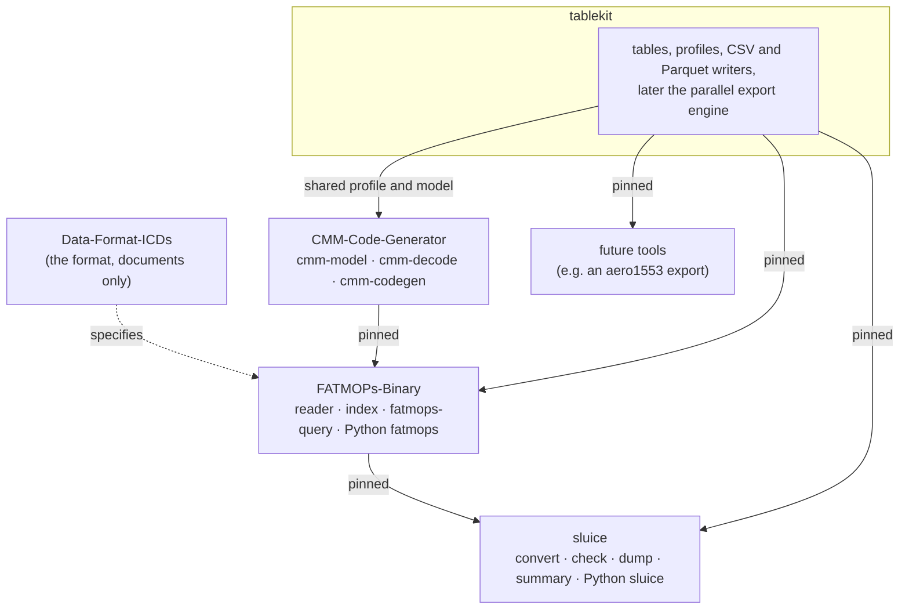
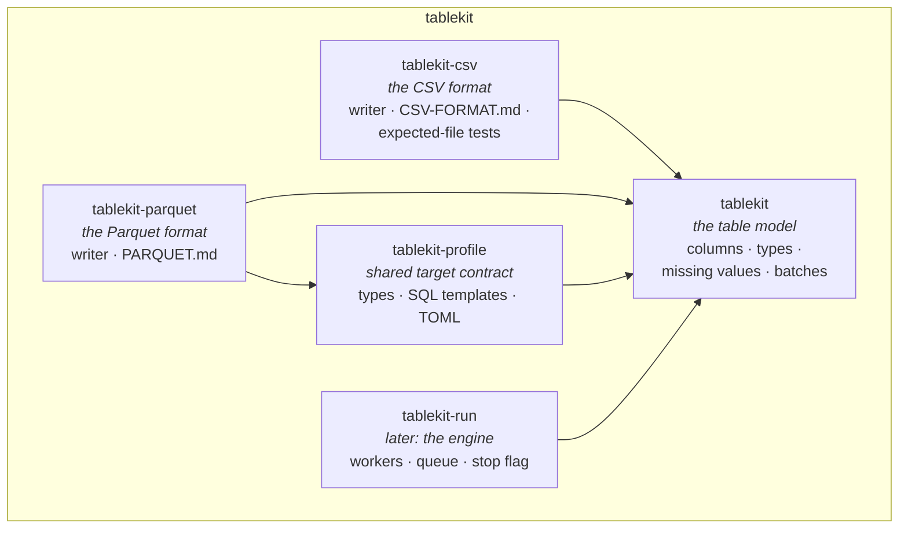
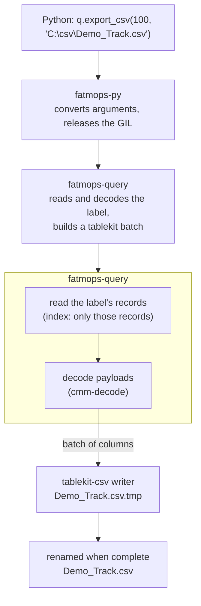
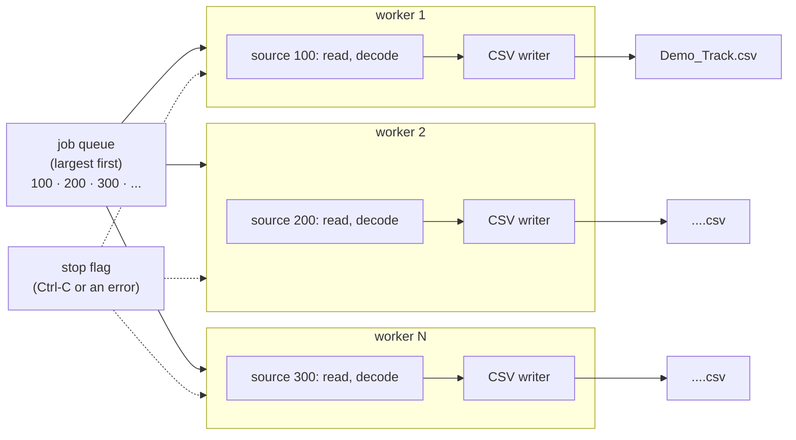
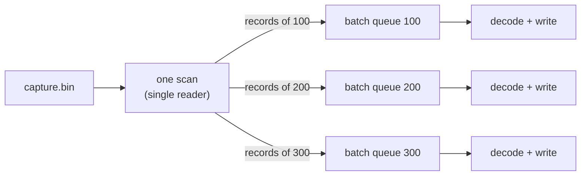

# Architecture

How tablekit fits among the FATMOPs repositories, what is inside it, how an export runs, and
where concurrency will go. First written 2026-10-18 as a proposal; the decisions at the end
were made the same day.

For the current crate inventory, ASCII/Binary/sluice boundaries and improvement status,
see [PROJECT-MAP.md](PROJECT-MAP.md). The concurrency sections below remain a design plan;
the implemented driver is serial `tablekit::copy`.

## Contents

- [Why one library](#why-one-library)
- [Where it sits among the repositories](#where-it-sits-among-the-repositories)
- [What is inside it](#what-is-inside-it)
- [One export, end to end](#one-export-end-to-end)
- [Where the concurrency will happen](#where-the-concurrency-will-happen)
- [How each tool uses it](#how-each-tool-uses-it)
- [Order of work](#order-of-work)
- [Decisions](#decisions)

## Why one library

FATMOPs-Binary, sluice and the tools still to come all turn records into tables and write
them out. One library owns that output, so every CSV has the same format and the parallel
work happens in one place.

- **Its own repository.** It serves FATMOPs-Binary, sluice and tools that have nothing to do
  with FATMOPs, such as a future aero1553 export. So it can't live inside any of them, and it
  depends on none of them. Users pin it by commit, as they pin `cmm-decode`.
- **The concurrency lives here.** tablekit will own the worker pool, the scheduling,
  cancellation and safe file writing. Each tool supplies only a *source*, which says how to
  read and decode its own records. The engine is written and tested once.
- **Same format every time.** tablekit holds the one written definition of each format
  ([CSV-FORMAT.md](CSV-FORMAT.md), [PARQUET.md](PARQUET.md)), and tests check every byte
  against expected files. Every tool writes through it, so no tool can drift.

## Where it sits among the repositories

Dependencies run one way only: tablekit knows nothing about captures or CMM XML.
FATMOPs-Binary and sluice depend on it. CMM-Code-Generator also uses `tablekit-profile`
and the table model for the shared SQL/Parquet type contract.

An arrow points from the library to the repository that uses it. A solid arrow is a git
dependency pinned to one commit.

## What is inside it

Small crates, so a tool takes only what it needs. The table model has no dependencies at all.

| Crate | Holds | Why separate |
|---|---|---|
| `tablekit` | Columns (names and types: bool, signed and unsigned integers, float, double, text), which rows are missing, and batches of columns. Writing a file whole or not at all. | Every tool fills the same shape, so every writer can take any tool's data. |
| `tablekit-csv` | The CSV writer and [CSV-FORMAT.md](CSV-FORMAT.md). | The format is decided once and tested against expected files. |
| `tablekit-parquet` | The Parquet writer and [PARQUET.md](PARQUET.md): the types Impala reads, matching the tables `cmm-gen` makes. | Loading Impala needs Parquet. The same model makes it a second writer, not a second system. |
| `tablekit-profile` | Validated SQL/Parquet mappings, SQL comment templates and record/partition policy from TOML ([PROFILES.md](PROFILES.md)). | SQL generation and Parquet encoding consume one explicit contract. |
| `tablekit-run` (later) | The export engine: many jobs on a pool of threads. | Concurrency is written and tested once, for every tool. |

## One export, end to end

This is `export_csv.py` in FATMOPs-Binary. Python makes one call, and everything below it runs
in Rust with the GIL released, so nothing is copied into Python.

| Step | Owner | Knows about |
|---|---|---|
| Reading records | FATMOPs-Binary (`fatmops-query`) | captures, the index |
| Decoding payloads | CMM-Code-Generator (`cmm-decode`) | the CMM XML |
| Turning decoded fields into a batch | FATMOPs-Binary (`fatmops-query`) | both, and the table model |
| Scheduling, threads, stop (later) | tablekit (`tablekit-run`) | jobs only |
| Bytes on disk | tablekit (`tablekit-csv`, `tablekit-parquet`) | the table model only |

## Where the concurrency will happen

Not in the first release, which writes one table at a time. The engine will keep a few
workers busy. Each worker takes the largest job left, reads and decodes it batch by batch,
and writes each batch as it arrives. With an index, each worker reads only its own label's
records from its own file handle; `fatmops-query` already allows this, since it holds no lock
and opens the capture separately for every read.

Rules the engine will enforce for every tool:

- **Workers:** at most the number of cores, and never more than the number of jobs. One big
  label doesn't start last, because the largest go first.
- **Memory stays bounded:** a source hands over batches of a fixed number of rows, not a whole
  label at once. The writers already take a table in several batches (`CsvWriter`,
  `ParquetWriter`).
- **Stopping:** Ctrl-C or the first error sets one flag, checked between batches. Finished
  files stay; unfinished ones are removed.
- **No half-written files:** each file is written as `.tmp` and renamed when complete, as the
  first release already does.
- **The same bytes either way:** one worker or sixteen, the output is identical. A test
  checks this.

Without an index, each label would need a full scan of the capture. Instead, one reader scans
the file once and routes each record to its label's job; the decode and write steps still run
in parallel.

## How each tool uses it

| Tool | Before tablekit | With tablekit |
|---|---|---|
| FATMOPs-Binary, Python | `export_csv.py`: Rust decodes, pandas writes. | `q.export_csv(label, path)` and `q.export_parquet(label, path)`: pandas is not needed to write files; `to_pandas()` stays for analysis. |
| sluice `dump --format csv`, `summary --format csv` | Its own CSV code. | Implemented through `tablekit-csv`; dump formats rows directly, while the shared contract keeps quoting, numbers and line endings consistent. |
| sluice, Python | `sluice.dump`, `sluice.summary` | Unchanged calls; the format comes from tablekit. |
| sluice load | Previously not built. | Implemented through `fatmops-query` and `tablekit-parquet`, writing partition directories and load SQL. Actual cluster application is separate. |
| Future tools | - | Build a table; get CSV, Parquet and, later, parallelism. |

The Python packages stay thin layers over Rust: each exposes its own export as a
pass-through. tablekit itself has no Python, so the format can't depend on which language
wrote it.

## Order of work

| When | What |
|---|---|
| **0.1.0, the first release** | The table model, the CSV writer (pandas' format) and the Parquet writer (Impala's types), single-threaded. FATMOPs-Binary's `export_csv.py` uses it. |
| 0.3 | sluice's CSV output moves onto tablekit (`CsvFormat`, a row at a time); `encoding` replaces `bom`. |
| **0.4.0** | `Source`, `BatchWriter` and the single-threaded driver `copy`; text columns in one buffer. sluice writes Parquet through it. |
| **0.5.0** | `tablekit-profile`: SQL/Parquet type mappings and SQL comment templates shared with CMM-Code-Generator. |
| After the first release | `tablekit-run`, the concurrent driver, evaluated against the serial one with and without threads, thread start-up included (ROADMAP.md). |

### Rows or batches

A source can reach a writer as whole batches (`Source`, `copy`) or a row at a time
(`CsvFormat`). Both write the same bytes. Which is faster depends on the tool: for sluice's
streaming CSV dump, gathering batches first measured 5 to 20% slower than formatting each
record as it is read, so it writes rows; Parquet needs whole columns, so it takes batches.
Measure before choosing.

A tool whose columns are fixed in its code can write a row a cell at a time (`RowWriter`),
one method per column named for its type and format. Nothing is looked up or dispatched per
cell, and each cell is followed by its separator rather than preceded by one, so the code is
what a hand-written writer for those columns would be: for aero1553's 46-column 1553
records it ran at 0.97 of the time of that tool's own writer, bytes identical. Whether each
method suits its column is checked in debug builds; the cell count, and quoting wherever text
needs it, in every build. `CsvFormat::row` remains the fully checked general way in.

## Decisions

Made with the owner on 2026-10-18.

| Question | Decision |
|---|---|
| Name | `tablekit`, a private repository of its own |
| Booleans | Booleans: `True` and `False` in CSV, `BOOLEAN` in Parquet |
| CSV in general | What pandas writes by default, because that is what users expect: see [CSV-FORMAT.md](CSV-FORMAT.md) |
| Line endings | CRLF, as pandas writes on Windows (and as RFC 4180 specifies); LF as an option |
| Byte-order mark | None by default, as pandas; `encoding="utf-8-sig"` adds one, named as pandas names it (0.3.0; 0.1.0 had a `bom` flag), so other encodings can follow without another interface change |
| Missing values | An empty cell, configurable like pandas' `na_rep` |
| Parquet | In tablekit too, in the first release |
| Concurrency | After the first release |

## Shared Parquet writer controls

Compression (Snappy/none/Gzip/Zstandard), dictionary encoding, data-page bytes and encoder
batch rows are tablekit-parquet options, shared by sluice convert/load and binary exports.
They do not alter profile type mappings. Partition directory selection, SQL registration,
ASCII forms and FATMOPs versions stay in the calling tools. See [PARQUET.md](PARQUET.md).
