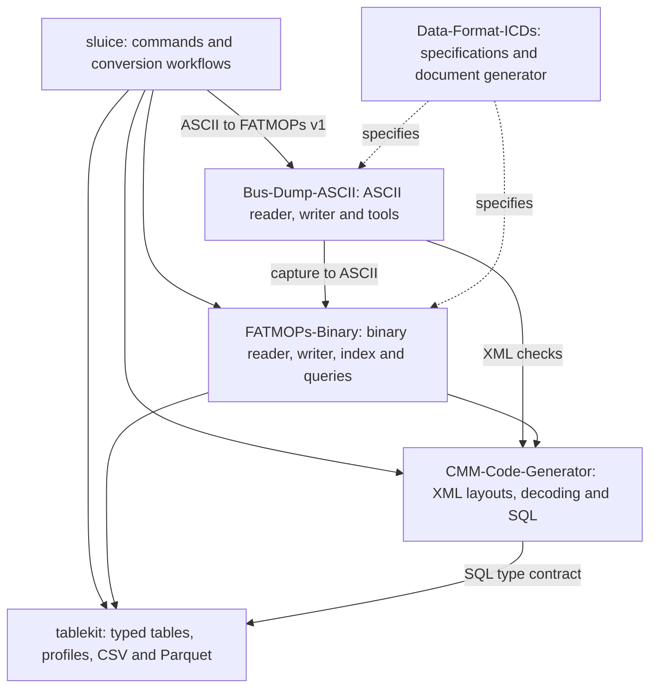
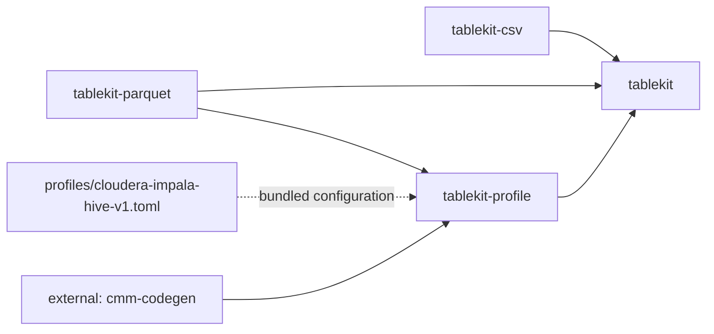

# Project crate and tool map

Use this map to choose where a change belongs before adding a new crate or conversion path.
The original crate inventory was checked on **2026-10-25**. Conversion, record-time and
release status were reconciled with committed source and tags on **2026-10-30**. Plans
are a summary of the existing roadmaps, not a delivery schedule.
**Implemented** means present in committed source, not necessarily a published release;
**planned** means not implemented;
**blocked** names a prerequisite; **deferred** means deliberately not active.

This page focuses on **tablekit**. The [complete project map](https://github.com/joey-huckabee/sluice/blob/main/docs/PROJECT-MAP.md)
contains every crate, tool, overlap comparison and the cross-repository improvement ledger.

## Repository map

Read arrows as **uses**, from caller to library. Dotted arrows are specifications or
planned integrations, as labeled. The diagrams describe project dependencies; third-party
crates and test-only dependencies are omitted unless noted.

| Repository | Owns | Current boundary |
|---|---|---|
| Bus-Dump-ASCII | ASCII parsing, format warnings, ASCII formatting, dump checking and the existing binary-to-ASCII tool | Supplies reader/swap primitives to sluice ASCII-to-v1 and direct Parquet routes; decoded CSV remains planned |
| FATMOPs-Binary | Container framing and I/O, sidecar indexes, indexed queries, decoded-message exports | Implements container version 1; low-level readers/writers treat payloads as opaque |
| CMM-Code-Generator | XML validation, message layouts/types/enums, runtime decoding, SQL/Rust generation and XML workload profiling | Takes labels and payload bytes; does not read captures |
| tablekit | Typed batches, common CSV/Parquet encoders, validated SQL/Parquet target profiles | Knows no capture format or CMM XML; no standalone CLI or Python package |
| sluice | File-oriented commands, record pipelines, record reports, table loading and partition directories | FATMOPs v1, ASCII-to-v1 and direct ASCII-to-Parquet routes are implemented; decoded CSV and EIE remain planned |
| Data-Format-ICDs | Container and ASCII format requirements, plus the generator for the Word ICDs | No Rust workspace or application runtime |

## tablekit crates

| Crate and source | Already implemented | Add functionality here when... |
|---|---|---|
| [tablekit](../crates/tablekit/src/lib.rs) | Typed columns and missing values, compact text buffers, batches and schemas; `Source`, `BatchWriter`, serial `copy` driver and atomic file helper | Adding a format-independent table primitive, source/writer interface or common file-writing helper |
| [tablekit-csv](../crates/tablekit-csv/src/lib.rs) | Batch/stream CSV writing and row-at-a-time `CsvFormat`; quoting, numeric text, missing values, encoding and line endings | Changing CSV output consistently for every consumer |
| [tablekit-parquet](../crates/tablekit-parquet/src/lib.rs) | Batch/stream Parquet writing with explicit schemas, nulls, row groups, compression/dictionary options, safe profile-driven coercions and exact full-range uint64 storage | Changing physical/logical Parquet encoding, supported coercions, buffering or row-group behavior |
| [tablekit-profile](../crates/tablekit-profile/src/lib.rs) | Strict TOML loading and validation; source-type to SQL/Parquet mappings; SQL header/comment templates and record/partition policy; shared `TargetProfile` | Extending the profile schema or validating a supported mapping; edit TOML for a target-specific mapping or wording change |

The editable default is
[profiles/cloudera-impala-hive-v1.toml](../profiles/cloudera-impala-hive-v1.toml).
`cmm-codegen` and the Parquet writer use the same validated mapping; data values are not
sampled to choose a type. Supported coercions are implemented and checked in Rust, so editing
TOML cannot enable an arbitrary lossy conversion. See [PROFILES.md](PROFILES.md).

There is no tablekit CLI or Python package. FATMOPs and sluice expose its writers through
their own APIs. `tablekit-run` is a planned concurrent driver, not a current crate;
`tablekit::copy` is the implemented serial driver.

## Development tools

Expected-file tests define CSV/Parquet output. Scripts under `testdata` generate invented
format expectations; library examples/benchmarks measure the writers. No concurrent engine
or standalone tablekit executable is hidden in the test tooling.

## Planned improvements and prerequisites

| Improvement | State | Owner / prerequisite |
|---|---|---|
| Concurrent export engine, proposed `tablekit-run` | Planned; crate does not exist | Profile read/decode/build/write stages first. Sources stay in consumers; engine owns workers, scheduling and cancellation. Require serial/threaded byte agreement and startup-cost measurements |
| Coalesce small batches into useful Parquet row groups | Planned | `tablekit-parquet`; choose target rows/bytes and bound buffering |
| Fewer decoder-to-table copies | Planned, needs measurement | Coordinate CMM typed buffers, `fatmops-query` batch construction and tablekit ownership; column decoding itself is already implemented |
| Additional CSV encodings | On request | `tablekit-csv`; keep common output contract and expected-file cases |
| Explicit shared SQL/Parquet types and comment templates | Implemented in 0.5.0 | `tablekit-profile` and TOML; CMM has schema agreement tests |
| Serial `Source`/`BatchWriter` driver, compact text buffers and common CSV/Parquet writers | Implemented | `tablekit::copy` remains the available driver while concurrency is planned |

The [local roadmap](../ROADMAP.md) retains detailed rationale and open questions.
For changes across layers, use the [feature placement guide](https://github.com/joey-huckabee/sluice/blob/main/docs/PROJECT-MAP.md#where-a-new-feature-belongs).

## Shared storage and partition settings (released in 0.6.0)

`tablekit-parquet` owns Snappy/none/Gzip/Zstandard, dictionaries, data-page bytes and encoder
batch rows. `tablekit-profile` selects/orders the known capture partition declarations while
preserving types/comments. CMM emits those declarations; sluice convert/load uses matching
directories. Sluice file conversion omits registration SQL, while warehouse load emits it.
No format routing, capture decoding or partition directory I/O is added to tablekit.

### Reusable comment rendering

`tablekit-profile::render_into` owns shared template parsing and appends into a caller's
String. The SQL generator owns per-table buffer reuse; tablekit owns substitution/error
policy. See [the API contract](PROFILES.md#rendering-into-reusable-buffers). No CSV/Parquet
row loop, storage format or shared profile mapping changes.
